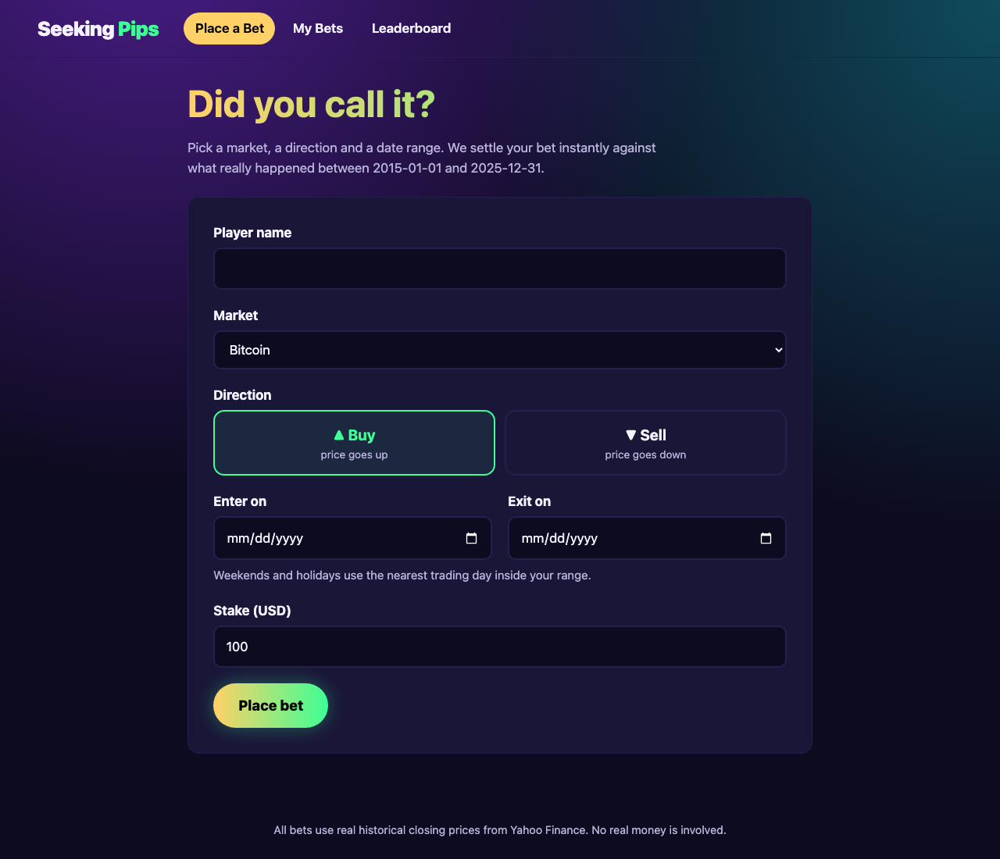
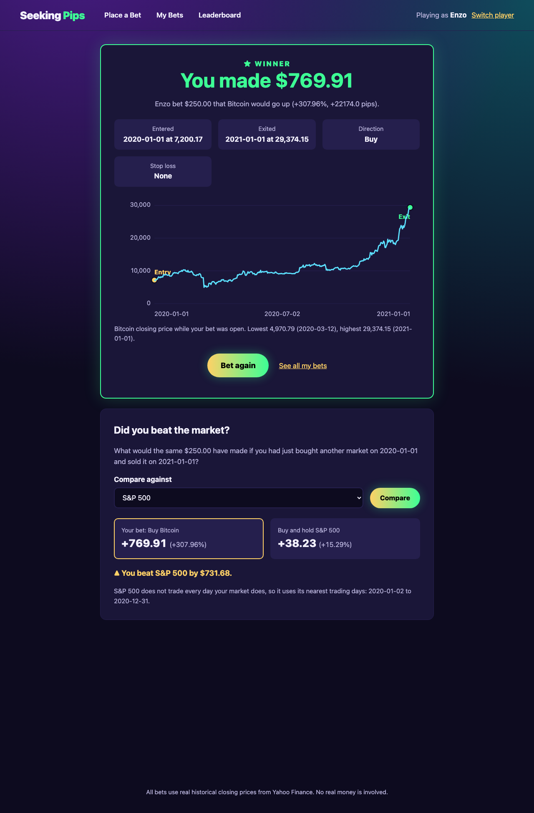

# Seeking Pips

Seeking Pips is a betting game played on market history. Pick a market (S&P 500,
gold, EUR/USD, Bitcoin and more), choose **Buy** if you think the price went up
or **Sell** if you think it went down, then set an entry date, an exit date and
a stake. The site settles the bet straight away against real 2015–2025 closing
prices and tells you whether you won or lost, by how much, and how many pips
the market moved. Then it asks the question every trader should: **did you beat
the market?**



## Flagship feature: Did you beat the market?

Every bet result now has a **Compare against** form. Pick any of the other nine
markets and the page shows what the same stake would have made by simply buying
and holding that market over the bet's real dates, side by side with the bet,
and says who came out ahead and by how much. It starts on the S&P 500 (gold for
bets on the S&P 500 itself), and because it is a GET form every comparison has
its own URL, e.g. `/bet/5?vs=GC%3DF`.

Week 10 also adds:

- **Stop loss** (optional): close the bet early once it has lost a chosen
  percent of the stake.
- **Charts**, drawn on the server as SVG with no JavaScript: the market's price
  while the bet was open (entry, exit and stop level marked) on the result
  page, and the player's running total after each bet on My Bets.



## Pages

| Page | URL | What it does |
| --- | --- | --- |
| Place a Bet | `/` | Form to pick a player name, market, direction, dates and stake |
| Bet Result | `/bet/<id>` | Win/loss, profit, pips, a price chart and the "beat the market" comparison (`?vs=SYMBOL`) |
| My Bets | `/history` | Win rate, net result, best/worst bet, a running-total chart and a table of every bet |
| Leaderboard | `/leaderboard` | Top 25 players ranked by total profit |

## What is stored in the database

SQLite (`instance/seeking_pips.db`, schema in `code/schema.sql`) holds four tables:

- **assets**: the 10 tradable markets and their pip size (e.g. 0.0001 for EUR/USD)
- **prices**: about 29,000 daily closing prices, loaded from `data/prices.csv` on first start
- **players**: everyone who has placed a bet (names are case-insensitive)
- **bets**: every bet placed, with entry/exit prices, pips, profit and the
  optional stop loss (whether it triggered, and the exit originally planned)

## How a bet is settled

1. The entry date moves forward to the first trading day on or after it, and the
   exit date moves back to the last trading day on or before it (markets are
   closed on weekends and holidays).
2. If a stop loss is set, each daily close after entry is checked. The first
   close where the bet is down by the stop percent or more becomes the exit.
   There is one price per day, so a big one-day move can lose a little more
   than the stop (buying the S&P 500 on 2020-02-19 with a 10% stop exits on
   2020-02-27 at −12%).
3. `profit = stake × (exit − entry) / entry`, negated for a Sell.
4. `pips = (exit − entry) / pip_size`, also negated for a Sell.
5. The benchmark is a Buy of the chosen market over the same entry and exit
   dates, moved to that market's own trading days (Bitcoin trades on weekends,
   the S&P 500 does not).

The logic lives in `code/betting.py`; the charts are laid out in
`code/charts.py` and drawn by `code/templates/_chart.html`.

## Repository layout

```
code/       Flask app (app.py), database helpers (db.py), bet logic (betting.py),
            SVG chart layout (charts.py), schema.sql, templates/ (HTML)
            and static/ (CSS)
data/       assets.csv, prices.csv and fetch_prices.py, which downloads them
tests/      pytest unit and integration tests, plus test_results.txt
docs/       Screenshots
report/     Final report
Dockerfile  Container image definition
```

## Running it in a container (recommended)

Requires [Docker](https://www.docker.com/).

```bash
git clone <this repository URL> seeking-pips
cd seeking-pips
docker build -t seeking-pips .
docker run -d --name seeking-pips -p 8000:5000 \
    -v seeking-pips-data:/app/instance seeking-pips
```

Open <http://localhost:8000>. The app listens on port 5000 inside the container.
It is mapped to 8000 on the host because macOS uses port 5000 for AirPlay.

The `-v seeking-pips-data:/app/instance` volume keeps players and bets when the
container is removed and started again. Useful commands:

```bash
docker logs seeking-pips              # view server logs
docker exec seeking-pips python -m pytest -v   # run the tests in the container
docker rm -f seeking-pips             # stop and remove the container
docker volume rm seeking-pips-data    # wipe all players and bets
```

Set `SECRET_KEY` to a random value outside local testing, for example
`docker run -e SECRET_KEY=... ...`.

**Upgrading from the Week 9 container:** rebuild the image, remove the old
container and start a new one with the same `-v seeking-pips-data:/app/instance`
volume. On startup the app adds the new stop loss columns to the existing
database, so players and bets are kept.

## Running it without Docker

Requires Python 3.12 or newer.

```bash
python3 -m venv .venv
source .venv/bin/activate
pip install -r requirements.txt
python code/app.py        # development server at http://127.0.0.1:5000
```

## Reproducing results

- **Tests:** `python -m pytest -v` runs 52 unit and integration tests. They cover
  bet math, input validation, weekend date handling, database loading and
  upgrading a Week 9 database, form labels, the stop loss (including a real
  2020 crash), the benchmark comparison, chart layout and the full
  bet → history → leaderboard flow. The output of a run inside the container
  is saved in `tests/test_results.txt`.
- **Price data:** `pip install yfinance pandas && python data/fetch_prices.py`
  downloads `data/prices.csv` again from Yahoo Finance. The site itself never
  needs network access.
- **Example bet:** a $250 Buy on Bitcoin from 2020-01-01 to 2021-01-01 wins
  $769.91 (+308%), and beats buying the S&P 500 over the same year by $731.68.

## Accessibility

- Every form control has a visible `<label>`. Buy/Sell is a real radio group in a
  `<fieldset>` with a `<legend>`.
- Everything works by keyboard: a skip link, a visible focus ring on all
  controls, and `aria-current` on the current page in the navigation.
- Errors are announced with `role="alert"`. Win and loss are spelled out in words
  and symbols, not shown by colour alone.
- Charts are `role="img"` SVGs with a title and a text description, and each
  has a visible caption with the key numbers, so nothing is shown only as a
  picture.
- Tables have captions and header scopes. Colours meet WCAG AA contrast, and
  animations are turned off for `prefers-reduced-motion`.

## Technologies

- **Python 3.12** with **Flask 3.1** (web framework) and **gunicorn** (production server)
- **SQLite** (built into Python) for storage
- **HTML** with Jinja2 templates, and hand-written **CSS** (no frameworks)
- **pytest** for testing
- **Docker** for the container
- **yfinance** (data preparation only) for Yahoo Finance prices

## Deployment

- [x] Container built and tested locally (Week 9, updated for Week 10)
- [ ] Deployed on Discovery

## Final demonstration

Video attached in Canvas submission.

## Author

**Enzo Nunez** (enzonunez@vt.edu): project idea, design, implementation,
testing and documentation.

## Honor code and LLM statement

**Honor code:** As a Hokie, I will conduct myself with honor and integrity at all times. I will not lie, cheat, or steal, nor will I accept the actions of those who do.

**LLM use:** I used Claude Code by Anthropic for code generation and debugging.

Every source, template, config and test file starts with the same two
statements in a comment. Data files (`data/*.csv`) and screenshots
(`docs/*.png`) cannot hold comments, so this README covers them.
